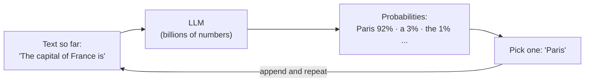
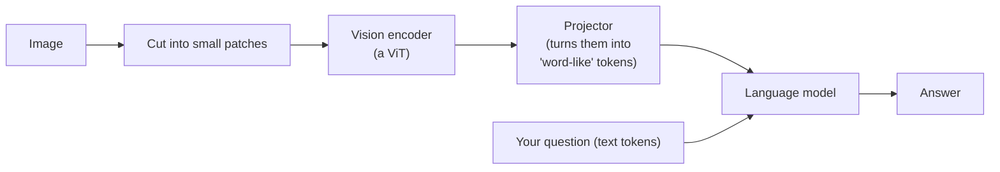
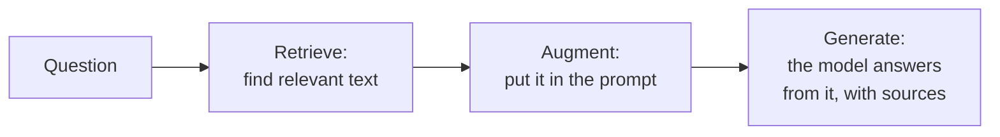
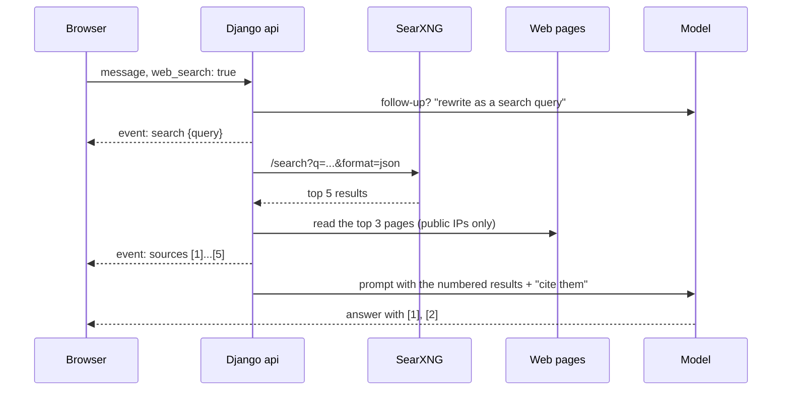
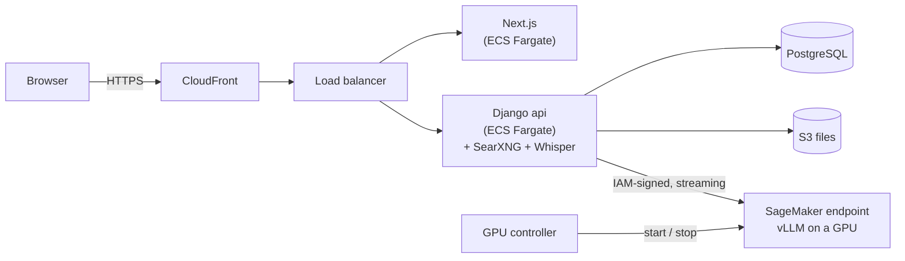
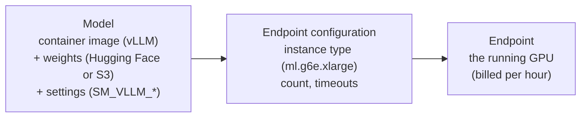

# Concepts: how private LLMs work, and how this app is built

Every idea behind this project in one place: what a token is, why an 8B model needs
16 GB, why answers loop, how web search makes an old model current, and how a
message travels from the browser to a GPU and back. Each section gives the idea, the
numbers, and where it lives in the code.

Read it top to bottom, or jump to what you need. Each concept starts with a
**one-sentence** version.

- **Part 1. How LLMs work:** [what an LLM is](#11-what-an-llm-is) ·
  [tokens](#12-tokens) · [parameters and model size](#13-parameters-and-model-size) ·
  [kinds of models](#14-training-and-kinds-of-models) · [the chat format](#15-the-chat-format) ·
  [context window](#16-the-context-window) · [sampling](#17-sampling-temperature-top-p-penalties) ·
  [hallucinations](#18-hallucinations-and-the-knowledge-cutoff) ·
  [vision models](#19-vision-language-models) · [thinking models](#110-reasoning-thinking-models)
- **Part 2. Running a model:** [memory](#21-where-the-memory-goes) ·
  [quantization](#22-precision-and-quantization) · [speed](#23-speed-prefill-and-decode) ·
  [hardware](#24-the-hardware) · [inference engines](#25-inference-engines) ·
  [choosing a model](#26-choosing-a-model-and-a-gpu)
- **Part 3. Making answers better:** [prompt building](#31-building-the-prompt) ·
  [RAG](#32-rag-retrieval-augmented-generation) · [web search](#33-web-search-in-this-app) ·
  [tool calling](#34-tool-calling-how-chatgpt-decides-to-search) ·
  [speech to text](#35-speech-to-text-whisper) · [OCR](#36-ocr-reading-text-from-images)
- **Part 4. The app, end to end:** [the big picture](#41-the-big-picture) ·
  [pressing Send](#42-what-happens-when-you-press-send) · [streaming](#43-streaming-server-sent-events) ·
  [accounts and security](#44-accounts-and-security) · [files](#45-files-and-storage) ·
  [running locally](#46-running-it-locally) · [running on AWS](#47-running-it-on-aws) ·
  [SageMaker](#48-sagemaker-hosting) · [the GPU controller](#49-the-gpu-controller-and-cost) ·
  [privacy](#410-privacy-by-design) · [infrastructure as code](#411-infrastructure-as-code-and-cicd)
- **Part 5. Explaining it:** [the pitch](#51-the-pitch) ·
  [design decisions](#52-design-decisions-and-their-trade-offs) ·
  [questions people ask](#53-questions-people-ask) · [numbers to remember](#54-numbers-worth-remembering)
- [Glossary](#glossary)

---

## Part 1. How LLMs work

### 1.1 What an LLM is

**In one sentence:** a large language model is a function that, given some text,
predicts the most likely next piece of text, and it writes whole answers by doing
that over and over.

The model never "looks up" an answer. It reads everything so far (your question, the
conversation, any documents), computes a probability for every possible next
**token** (a word or piece of a word), picks one, appends it, and repeats. That loop
is called **autoregressive generation**, and it's why answers appear word by word.



Inside, almost every modern LLM is a **transformer**: a stack of identical layers
(36 in an 8B Qwen model). Each layer has an **attention** step, where every token
looks at the tokens before it to decide what matters, and a **feed-forward** step,
where most of the model's "knowledge" is stored. The numbers inside these layers
are the model's **parameters** (or **weights**).

### 1.2 Tokens

**In one sentence:** models read and write tokens, not letters or words, and almost
everything (limits, speed, price) is counted in tokens.

A **tokenizer** splits text into tokens from a fixed vocabulary of about 100,000–
150,000 pieces. Common words are one token; rare words are split; code and other
languages use more tokens per word.

| Text | Roughly |
|---|---|
| 1 token, English | ~4 characters, ~¾ of a word |
| 1,000 tokens | ~750 English words, about 1.5 pages |
| A 10-page PDF | ~5,000–7,000 tokens |
| A screenshot, for a vision model | ~1,000–3,000 tokens |

Why it matters:

- **Limits** are in tokens: the context window (1.6) and `max_tokens` for an answer.
- **Speed** is in tokens per second.
- **Cost** on hosted APIs is per token. Here you pay per GPU hour instead, but a long
  prompt still costs time.
- Every answer reports `usage`: **prompt tokens** (what the model read) and
  **completion tokens** (what it wrote). The app shows them under each answer.

**In this app:** without a real tokenizer, the backend estimates **3 characters per
token** (`estimate_tokens` in `backend/apps/chat/prompting.py`). That overcounts a
little on purpose: better to trim a prompt slightly early than to send one the
server rejects.

### 1.3 Parameters and model size

**In one sentence:** "8B" means 8 billion parameters; more parameters mean more
knowledge and better reasoning, but more memory and slower answers.

| Size | Examples | Good at | Weak at |
|---|---|---|---|
| 1–4B | Qwen3-VL 4B, Llama 3.2 3B, Gemma 3 4B | Chat, summaries, simple Q&A, OCR, running on a laptop | Facts (mixes them up), long documents, hard reasoning |
| 7–14B | Qwen3-VL 8B, Llama 3.1 8B, Gemma 3 12B | Most everyday work; good with documents | Expert topics, long multi-step reasoning |
| 30–70B | Qwen3 32B, Llama 3.3 70B | Close to the big hosted models for many tasks | Needs a big GPU (or several) |
| 100B+ | Large MoE models | Frontier quality | Needs a cluster |

Two kinds of model architecture:

- **Dense**: every parameter is used for every token. An 8B dense model does 8
  billion parameters' worth of math per token.
- **Mixture of Experts (MoE)**: the feed-forward part is split into many "experts",
  and a small router picks a few for each token. A name like **30B-A3B** means 30B
  parameters in total, 3B **active** per token: it needs memory for all 30B, but runs
  about as fast as a 3B model.

You saw the size trade-off in this project: Qwen3-VL **4B** sometimes mixed up facts
(Pakistan "bordered by India to the east, west, and south"); the **8B** was more
careful; neither knew events after its training without web search.

### 1.4 Training, and kinds of models

**In one sentence:** a model is trained once (expensively) and then used for
**inference** (cheaply, many times); this project only does inference.

- **Pre-training**: the model reads trillions of tokens of text and learns to predict
  the next one. The result is a **base model**: it continues text, but doesn't follow
  instructions well.
- **Instruction tuning** (and RLHF): further training on conversations, so the model
  answers questions and follows instructions. The result is an **instruct** or
  **chat** model (the `-Instruct` / `-it` in model names). These are what you chat
  with.
- **Thinking / reasoning models**: trained to write out their reasoning before the
  answer (1.10).
- **Open-weight models**: the weights are published (Qwen, Llama, Gemma, Mistral,
  DeepSeek...), so you can run them yourself. That is what makes a private LLM
  possible. Each has a licence: Apache-2.0 (Qwen) is permissive; Llama and Gemma
  have their own terms, and some are **gated** (you accept the licence on Hugging
  Face before downloading).
- **Closed models** (GPT, Claude, Gemini) are only available through their
  company's API: your data goes to them.
- **Fine-tuning**: training an open model a little more on your own data. Not done in
  this project (it changes style and format well, but is a poor way to add facts;
  for facts, use retrieval, 3.2).

**Where models come from:** [Hugging Face](https://huggingface.co) is the main hub
(SageMaker's vLLM downloads from there). Ollama has its own library
([ollama.com/library](https://ollama.com/library)), Docker has `ai/...` models on
Docker Hub.

### 1.5 The chat format

**In one sentence:** a chat model has no memory, so every turn the app sends the
whole conversation again as a list of messages with roles.

```json
[
  {"role": "system",    "content": "You are Private LLM Chat, running Qwen3-VL 8B. Today's date is ..."},
  {"role": "user",      "content": "Who is the prime minister of Pakistan?"},
  {"role": "assistant", "content": "As of my training data (2024), ..."},
  {"role": "user",      "content": "And the president?"}
]
```

- The **system** message sets the rules: who the assistant is, the date, how to
  format, how to treat files and search results. Users don't see it.
- **user** and **assistant** alternate. "Memory" is just this list growing.
- The inference server turns the list into the model's own text format with a
  **chat template**: special tokens like `<|im_start|>user ... <|im_end|>` (Qwen's
  ChatML) or `<|start_header_id|>user<|end_header_id|>` (Llama). Some templates
  reject two user messages in a row, so the backend merges them
  (`_merge_same_roles` in `prompting.py`).
- This format is the **OpenAI chat-completions** format, and nearly every server
  accepts it (2.5). That is why one backend works with SageMaker, Ollama, Docker
  Model Runner and OpenAI alike.

A side effect you saw: the model imitates its own earlier answers in the same chat.
After one looping answer ("Wait, correction..."), the next one in that chat looped
too, even after the fix. A new chat started clean.

### 1.6 The context window

**In one sentence:** the context window is how many tokens the model can read and
write at once: the system prompt, the conversation, files, search results, *and* the
answer all have to fit.

```
context window (e.g. 8,192 tokens)
├── system prompt + instructions        ~300
├── earlier conversation                ~2,000
├── attached document / search results  ~3,000
├── your question                       ~50
└── room left for the answer            ~2,800
```

- Models are trained with a maximum (32K, 128K, 256K...), but the **server** decides
  how much it actually allows, because every token of context costs GPU memory
  (the KV cache, 2.1). Locally this app uses **8,192**; on SageMaker the presets use
  **32,768** (`max_model_len`).
- Too much text? Something has to go. The backend trims in a fixed order (3.1):
  the oldest plain turns first, then the biggest documents, and only then refuses
  with `context_too_long`.
- Long context isn't free even when it fits: the model reads it all before writing
  (prefill, 2.3), and small models get "lost in the middle" of long documents.

### 1.7 Sampling: temperature, top-p, penalties

**In one sentence:** the model gives probabilities; **sampling settings** decide how
adventurous the pick is, and the right ones stop small models from rambling or
repeating themselves.

| Setting | What it does | Typical |
|---|---|---|
| `temperature` | Sharpens (low) or flattens (high) the probabilities. 0 = always the most likely token (deterministic, "greedy") | 0.6–1.0 for chat, 0 for OCR and extraction |
| `top_p` | Only pick among the most likely tokens that together make p of the probability ("nucleus") | 0.8–0.95 |
| `top_k` | Only pick among the k most likely tokens | 20–64 |
| `presence_penalty` | Lowers the score of any token that has already appeared | 0–2; Qwen recommends 1.5 for Qwen3-VL |
| `frequency_penalty` | Lowers it more each time the token appears | 0–1 |
| `max_tokens` | Hard stop for the answer's length | 2,048 here |

**Each model's authors publish recommended settings** in its model card, and small
models really need them. Without `presence_penalty`, Qwen3-VL 8B answered "who is the
president?" by repeating "Wait, correction: ..." for 800 tokens. With the recommended
settings, it answered once.

**In this app:** each model has `temperature` and `params` (e.g.
`{"top_p": 0.8, "top_k": 20, "presence_penalty": 1.5}`), sent with every chat request
(`backend/apps/chat/streaming.py`). `make up` fills them in from the model cards
(`scripts/up.sh`). OCR uses temperature 0 and no penalty: a repetition penalty would
change a transcription where the same number really appears twice.

### 1.8 Hallucinations and the knowledge cutoff

**In one sentence:** a model always produces fluent text, whether or not it knows the
answer, and it knows nothing after its **training cutoff**.

- **Hallucination**: a confident, wrong answer. The model predicts plausible text; it
  has no built-in sense of "I don't know". Small models hallucinate more.
- **Knowledge cutoff**: training data ends at some date (2024–2025 for the models
  here). Ask about anything later, or anything that changed (who holds an office,
  prices, news), and the model can only guess from old data.
- Telling it today's date isn't enough. Qwen3-VL knew it was 2026 but only had 2024
  facts, and argued with itself between the two.

What reduces it, from cheapest to strongest:

1. **Instructions** in the system prompt: say which year your information is from,
   don't go back and forth, don't claim you checked a website
   (`KNOWLEDGE_INSTRUCTIONS` in `prompting.py`).
2. **Better sampling settings** (1.7) against loops.
3. **A bigger model.**
4. **Grounding**: give the model the facts in the prompt and tell it to answer from
   them. Attached documents and web search (3.2, 3.3) do exactly that. This is the
   only one that makes an old model *current*.

### 1.9 Vision-language models

**In one sentence:** a vision-language model (VLM) has an extra image encoder that
turns a picture into tokens the language model can read alongside text.



- An image costs roughly **one token per 28–32 pixel square** after the encoder: a
  1280×720 screenshot is about 1,000 tokens. The backend counts **1,500** per image to
  be safe, and shrinks images to 1,280 px on the long side.
- Every image is re-sent with the conversation each turn, so the app only sends
  images from the **last 2 user turns** (`IMAGES_FROM_LAST_N_TURNS`).
- In GGUF files (2.2), the vision part is a separate file called the **mmproj**
  (multimodal projector). The engine log says "loaded multimodal model" when it's
  there.
- Models without vision (`vision: false`) still get images: the app OCRs them first
  and sends the text (3.6).

### 1.10 Reasoning ("thinking") models

**In one sentence:** thinking models write out their reasoning before the final
answer, which makes them better at maths and logic, and slower.

- Examples: Qwen3 "Thinking", DeepSeek-R1. Many Qwen3 tags on Ollama are thinking
  models by default (`qwen3:4b` is the thinking one; `qwen3-vl:4b-instruct` is not).
- The reasoning comes inside `<think>...</think>` or in a separate
  `reasoning_content` field. The backend turns both into `<think>` blocks
  (`ChunkParser` in `apps/llm/providers/base.py`), and the UI shows them as a
  collapsible "Thought for 12 s" section.
- Older reasoning is stripped from the history before the next turn, to save context.
- Trade-off: a 3-sentence answer can come after 500 tokens of thinking. On a CPU, that
  is a minute of waiting.

---

## Part 2. Running a model: memory, speed and hardware

### 2.1 Where the memory goes

**In one sentence:** GPU memory holds the **weights** (fixed), the **KV cache**
(grows with context and users), and some working space; if they don't fit, the model
won't load, or will crawl.

```
GPU memory = weights + KV cache + activations/overhead (~10-20%)
weights    = parameters × bytes per parameter
KV cache   = 2 × layers × KV heads × head size × bytes per value × tokens
             (K and V)                                       (all users' tokens)
```

**Weights**, for an 8B model:

| Precision | Bytes per parameter | 8B model |
|---|---|---|
| FP32 | 4 | 32 GB (nobody serves this) |
| BF16 / FP16 | 2 | 16 GB |
| FP8 / INT8 | 1 | 8 GB |
| 4-bit (Q4_K_M, AWQ) | ~0.5–0.6 | ~4.8 GB |

**The KV cache** is the model's short-term memory of the context: for every token
read, each layer stores a **key** and a **value** vector so it doesn't recompute them
for the next token. Worked example, Qwen3-VL 8B (36 layers, 8 KV heads, head size
128, 16-bit values):

```
2 × 36 × 8 × 128 × 2 bytes = 147,456 bytes ≈ 144 KB per token
 8,192 tokens  ≈ 1.2 GB
32,768 tokens  ≈ 4.8 GB  (one user with a full context, or 4 users with 8K each)
```

So Qwen3-VL 8B at 4-bit on a laptop needs about 4.8 GB (weights) + 1.2 GB (8K KV
cache) + ~1 GB (the vision encoder and working memory) ≈ **7.5 GB**. That's exactly
what Docker Model Runner's process used in this project.

**GQA** (grouped-query attention) is why "8 KV heads" is small: the model has 32
attention heads, but they share 8 sets of keys and values, which makes the KV cache
4× smaller. Nearly all recent models use it.

**When it doesn't fit:** on a GPU, the server refuses to start ("CUDA out of memory",
"KV cache can't hold max_model_len"). On a Mac, where the GPU shares memory with
everything else (**unified memory**), macOS swaps to disk instead, and the model gets
slower than a CPU: the 8B model dropped to ~5 tokens/s on a 16 GB Mac with Docker
Desktop holding 8 GB. `scripts/up.sh` now checks the memory left next to Docker and
recommends a model that fits.

### 2.2 Precision and quantization

**In one sentence:** quantization stores each weight in fewer bits (16 → 8 → 4) to
cut memory and speed up generation, for a small loss in quality.

| Format | Used by | Bits per weight | Quality vs 16-bit |
|---|---|---|---|
| BF16 / FP16 | everything | 16 | reference. BF16 has FP32's range with less precision, so training prefers it |
| FP8 | vLLM on Ada/Hopper GPUs (L4, L40S, H100) | 8 | nearly identical |
| INT8 / Q8_0 | llama.cpp, Ollama | ~8.5 | nearly identical |
| Q6_K, Q5_K_M | llama.cpp | ~6.5, ~5.7 | very close |
| **Q4_K_M** | llama.cpp, Ollama, Model Runner (the usual default) | ~4.8 | small loss, the sweet spot |
| AWQ, GPTQ | vLLM | 4 | small loss |
| Q3, Q2, IQ2 | llama.cpp | 2–3.5 | noticeable loss; last resort |

- **GGUF** is llama.cpp's file format: one file with the weights, the tokenizer and
  the chat template. Ollama and Docker Model Runner use it. Names tell you the
  quantization: `Q4_K_M` = 4-bit, "K-quant", medium. `UD-Q4_K_XL` (Unsloth Dynamic)
  keeps the most sensitive layers at higher precision.
- **Safetensors** is Hugging Face's format for full-precision (or FP8/AWQ) weights,
  used by vLLM, which is what SageMaker runs.
- Rule of thumb: **a bigger model at 4-bit beats a smaller model at 16-bit** of the
  same memory. An 8B at Q4 (~5 GB) usually answers better than a 3B at FP16 (~6 GB).
- Quantization shrinks the weights; the KV cache can be quantized too (FP8 KV
  cache), which doubles the context that fits.

### 2.3 Speed: prefill and decode

**In one sentence:** reading the prompt (**prefill**) is limited by compute, writing
the answer (**decode**) is limited by memory bandwidth, and that explains most of
what you'll see.

- **Prefill**: the model processes all prompt tokens in parallel. Fast on a GPU
  (thousands of tokens per second), slow on a CPU (tens to hundreds). This is the
  wait **before the first word** (**time to first token**, TTFT). Long documents and
  web search results make it longer.
- **Decode**: one token at a time, and *every* token means reading all the weights
  from memory once. So:

```
max tokens/second (one user) ≈ memory bandwidth ÷ model size in memory
```

| Hardware | Memory bandwidth | 8B at 4-bit (~5 GB) | 8B at FP8 (~8 GB) |
|---|---|---|---|
| Laptop CPU (in Docker) | shared with everything; the CPU's math is the limit too | ~4–8 tok/s | slower |
| Apple M1 Pro GPU | 200 GB/s | ~40 tok/s max | ~25 tok/s |
| NVIDIA L4 (ml.g6) | 300 GB/s | ~60 | ~37 |
| NVIDIA A10G (ml.g5) | 600 GB/s | ~120 | ~75 |
| NVIDIA L40S (ml.g6e) | 864 GB/s | ~170 | ~108 |
| NVIDIA H100 | 3,350 GB/s | ~650 | ~400 |

Real numbers are 50–70% of these. Measured in this project on an M1 Pro: Qwen3-VL 4B
in Ollama on the CPU wrote **~8 tokens/s** and took **80–95 s** to read a receipt
photo; on the GPU with Model Runner, the 8B wrote **~20 tokens/s**, and a small vision
model read the photo in **2 s**.

**Batching** is how servers serve many users: generating for 32 users at once costs
almost the same memory reads as for one, so total throughput grows a lot while each
user's speed drops a little. vLLM's **continuous batching** adds new requests to the
running batch at every step instead of waiting for a batch to finish.

Reading people's numbers: **tokens/s per user** (how fast text appears), **total
throughput** (tokens/s across all users), **TTFT** (wait before the first token).

### 2.4 The hardware

**In one sentence:** what you can run is decided by memory size (does it fit?) and
memory bandwidth (how fast is it?).

**AWS GPUs for SageMaker** (us-east-1, on-demand, September 2026; [cost.md](cost.md)):

| Instance | GPU | Memory | $/hour | Fits |
|---|---|---|---|---|
| `ml.g6.xlarge` | 1× L4 (Ada) | 24 GB | 1.13 | 7–8B in FP8, moderate context |
| `ml.g5.xlarge` | 1× A10G (Ampere) | 24 GB | 1.41 | the same, faster, no native FP8 |
| `ml.g6e.xlarge` | 1× L40S (Ada) | 48 GB | 2.61 | 8B FP8 with 32K+ context, 14B, vision. **The default** |
| `ml.g6e.12xlarge` | 4× L40S | 192 GB | 13.12 | 70B in FP8, split over 4 GPUs |

- **Tensor parallelism** splits each layer across several GPUs of one machine
  (`tensor_parallel_size = 4`), for models too big for one GPU.
- **GPU generations:** Ampere (A10G, A100), Ada (L4, L40S), Hopper (H100). Ada and
  Hopper run FP8 natively.
- **Apple silicon** (M1–M4): CPU and GPU share one pool of **unified memory**, so a
  64 GB Mac can hold a model a 24 GB GPU can't. Bandwidth is lower than data-centre
  GPUs. Its GPU is programmed with **Metal**.
- **Docker on a Mac has no GPU**: containers run in a Linux virtual machine that
  can't see the Mac's GPU. That's why Ollama in a container is CPU-only on a Mac, and
  why Docker Model Runner runs the engine *outside* the VM (2.5).
- **CPU-only** works for small models (≤4B) and small jobs (speech to text with
  Whisper base), just slowly.

### 2.5 Inference engines

**In one sentence:** an inference engine loads the weights and serves the model over
an API; this project uses vLLM on AWS and llama.cpp (through Ollama or Docker Model
Runner) on laptops, all speaking the same OpenAI-style API.

| Engine | Where | Formats | Strengths |
|---|---|---|---|
| **vLLM** | SageMaker (AWS's vLLM container), any NVIDIA GPU | Safetensors (BF16, FP8, AWQ, GPTQ) | The standard for production serving: PagedAttention, continuous batching, high throughput, many users |
| **llama.cpp** | Anywhere: CPU, Metal, CUDA, Vulkan | GGUF | Runs well on laptops, small binaries, great quantization |
| **Ollama** | A friendly wrapper around llama.cpp | GGUF (its own library) | `ollama pull`, simple API, easy model management |
| **Docker Model Runner** | Part of Docker Desktop (and Docker Engine) | GGUF (llama.cpp), also vLLM and MLX | Models as Docker artifacts (`ai/...`), runs on the host GPU, declared next to your containers |
| **MLX** | Apple silicon | MLX | Apple's own framework, fast on Macs |

- **PagedAttention** (vLLM's key idea): stores the KV cache in small fixed-size pages,
  like an operating system's virtual memory, so it doesn't waste memory on gaps
  between requests. More users fit on one GPU.
- **The OpenAI-compatible API** is the common language: `POST /v1/chat/completions`
  with `messages`, `max_tokens`, `temperature` and `stream: true`. The answer streams
  back as Server-Sent Events, one small JSON chunk per token or few tokens, and the
  last chunk carries `usage`. Because every engine speaks it, the app has one
  provider for all of them (`apps/llm/providers/openai_compat.py`) and a separate one
  only for SageMaker's AWS-signed API (`apps/llm/providers/sagemaker.py`).
- **Locally**, `make up` picks an engine (`scripts/up.sh`): Docker Model Runner when
  there's a GPU it can use (it asks before turning it on), else Ollama in a container.

### 2.6 Choosing a model and a GPU

A checklist that works:

1. **What must it do?** Images or scans → a vision model (Qwen3-VL, Gemma 3). Maths
   and logic → a thinking model. Plain chat and documents → any instruct model.
2. **Pick the biggest model that fits** your memory with room for the KV cache:
   weights × ~1.2 + KV cache for the context you need.
3. **Quantize before shrinking**: an 8B at 4-bit before a 4B at 16-bit (2.2).
4. **Check the licence** (Apache-2.0 vs Llama/Gemma terms; gated or not).
5. **Use the model card's sampling settings** (1.7).
6. **Test with your own questions**, not benchmarks. Note where it fails: facts →
   add retrieval; reasoning → bigger or thinking model; speed → smaller or better
   hardware.

---

## Part 3. Making answers better

### 3.1 Building the prompt

**In one sentence:** the backend turns a conversation (plus files and search results)
into the list of messages the model reads, and trims it to fit the context window
(`build_prompt` in `backend/apps/chat/prompting.py`).

1. **System prompt**: the app's name, the model's name ("running the open-source
   model Qwen3-VL 8B"), today's date, Markdown, how to treat files. Then either the
   **search instructions** (cite results as [1]) or the **knowledge instructions**
   (answer once with the year of your information, don't claim you checked a
   website, suggest Search), plus the user's custom instructions.
2. **History**: every earlier message, with old `<think>` reasoning removed.
3. **Attachments**: documents become `<document name="...">text</document>` blocks;
   images go in as pictures (vision models, last 2 turns) or as OCR text.
4. **Search results**: `<search_results query="..." date="...">[1] Title, URL, page
   text ...</search_results>` on the question they were searched for (last 2 turns).
5. **Fitting**: the answer gets a budget (up to `max_output_tokens`, at least 256);
   if the rest is too long: drop the oldest turns without attachments, then trim the
   biggest documents (keeping their beginning, never below 1,000 characters), then
   give up with `context_too_long`.

### 3.2 RAG: retrieval-augmented generation

**In one sentence:** RAG means looking up relevant text first and putting it in the
prompt, so the model answers from facts it was just given instead of from memory.



The usual RAG over your own documents (not needed in this project yet):

1. **Chunk** documents into pieces of a few hundred tokens.
2. **Embed** each chunk: an **embedding model** turns text into a vector (a list of
   ~1,000 numbers) so that similar meanings get nearby vectors.
3. Store the vectors in a **vector database** (pgvector, OpenSearch, Qdrant...).
4. For a question, embed it, find the **nearest chunks** (top-k), optionally
   **re-rank** them, and put them in the prompt.

**What this project does instead:**

- **Attached files**: the *whole* text goes into the prompt, trimmed to fit. Simple,
  and fine for a few documents; for hundreds of pages or a whole library, you'd add
  chunking and embeddings.
- **Web search**: retrieval from the web (3.3). Same idea, the "database" is the
  internet.

RAG vs fine-tuning: RAG adds **knowledge** (current, citable, easy to update);
fine-tuning changes **behaviour** (style, format, a narrow task). For "the model
should know our policies", use RAG.

### 3.3 Web search in this app

**In one sentence:** with **Search** on, the app searches the web with a self-hosted
SearXNG, reads the top pages, and puts numbered results in the prompt, so the model
answers with current facts and [1], [2] citations (`backend/apps/chat/websearch.py`).



- **Query rewriting**: "and which party does he lead?" means nothing alone, so for
  follow-ups the model first writes a full query ("Which political party does
  Shehbaz Sharif lead?").
- **SearXNG** is an open-source **metasearch engine**: it asks Google, Bing,
  DuckDuckGo, Wikipedia... and merges the results. No API key, no tracking. It runs
  next to the api (`search/`; a compose service locally, a sidecar container on
  AWS). Search engines throttle automated queries (`too many requests`, CAPTCHA),
  more so from cloud IPs; SearXNG uses whichever engines answer.
- **Reading pages**: snippets are one sentence, often not enough, so the top 3 pages
  are fetched and their main text kept (2,500 characters each, menus and scripts
  removed).
- **SSRF protection**: fetching URLs for users is dangerous: a result could point at
  `http://169.254.169.254/` (the AWS metadata service, which hands out credentials)
  or an internal service. The app only fetches http(s) addresses that resolve to
  **public** IPs, and checks every redirect again.
- **Results are saved** on the user's message, so follow-ups and Regenerate still see
  them.
- **Privacy**: the search query and page requests leave your infrastructure (that's
  what searching is); the conversation doesn't. It's opt-in per message.

### 3.4 Tool calling: how ChatGPT decides to search

**In one sentence:** with tool calling, the model itself decides it needs a tool,
outputs a structured request ("search for X"), the app runs it and returns the
result, and the model continues.

```
user: who is the president of Pakistan now?
model: {"tool": "web_search", "arguments": {"query": "current president of Pakistan"}}
app:   runs the search, sends the results back as a "tool" message
model: The current president is ... [1]
```

- The app describes its tools (name, description, JSON parameters) in the request;
  models trained for it emit a **tool call** instead of text. vLLM needs flags for it
  (`SM_VLLM_ENABLE_AUTO_TOOL_CHOICE`, a parser).
- ChatGPT uses this to decide when to search, run code, or make images.
- **Why this app uses a button instead**: small models are unreliable at deciding,
  and every check costs an extra model call (seconds on a CPU). The button is
  predictable. Automatic search with tool calling is a natural next step on a big GPU
  model.
- **Agents** are tool calling in a loop: the model plans, calls tools, reads results,
  and repeats until done.
- **MCP** (Model Context Protocol) is a standard way to plug tools and data sources
  into models.

### 3.5 Speech to text (Whisper)

**In one sentence:** the microphone button records you in the browser, and
**Whisper**, OpenAI's open-source speech recognition model, turns it into text in a
container next to the api, so your voice never leaves your infrastructure.

- **Whisper** is an encoder-decoder transformer: audio becomes a spectrogram (a
  picture of sound frequencies over time), the encoder reads it, the decoder writes
  the text, in ~100 languages, detecting which one automatically.
- **Sizes**: tiny (75 MB), **base (142 MB, used here)**, small (466 MB, more accurate,
  especially for languages other than English), medium (1.5 GB), large-v3 (2.9 GB).
  `WHISPER_MODEL` chooses.
- **whisper.cpp** runs it efficiently on CPUs (the same people as llama.cpp). No
  official image exists for ARM, so `speech/Dockerfile` builds it from source.
- **The browser** records with `MediaRecorder` (WebM or MP4), then decodes and
  resamples to **16 kHz mono 16-bit WAV**, the format Whisper uses (32 KB per second;
  a minute ≈ 2 MB), so the server needs no audio converter (`frontend/src/lib/speech.ts`).
- **Why not the browser's built-in speech recognition?** In Chrome it sends your
  audio to Google's servers; that would break the "private" promise.
- Browsers only allow the microphone on `https://` pages and on `localhost`.

### 3.6 OCR: reading text from images

**In one sentence:** OCR turns an image of text into text; this app uses a vision
model when it has one, and **Tesseract** (classic OCR on the CPU) otherwise
(`backend/apps/files/ocr.py`).

- A **vision LLM** reads messy photos, handwriting, tables and layouts, and can keep
  structure as Markdown. Slow without a GPU (80–95 s on a laptop CPU, 2–3 s on a GPU).
- **Tesseract** is fast and cheap, good on clean scans, weak on photos and tables.
- Used two ways: the **OCR tool** (sidebar) and automatically for images sent to a
  model without vision.

---

## Part 4. The app, end to end

### 4.1 The big picture



| Piece | What | Why |
|---|---|---|
| **Next.js** (React, TypeScript) | The chat UI | The standard for chat UIs; a small standalone container |
| **Django + DRF** | The API: accounts, chats, files, models, streaming | Batteries included: auth, admin, migrations |
| **PostgreSQL** (RDS) | Users, conversations, messages, model registry | Reliable, managed backups |
| **S3** | Uploaded files | Durable, cheap, private |
| **SageMaker + vLLM** | The model on a GPU | Managed GPUs, IAM-only access |
| **SearXNG, Whisper** | Web search, speech to text | Self-hosted: no API keys, data stays in your account |
| **GPU controller** | Starts and deletes GPU endpoints | A forgotten GPU is the #1 surprise bill |
| **Terraform** | All of the above as code | Reproducible, reviewable infrastructure |

### 4.2 What happens when you press Send

1. **Browser** → `POST /api/conversations/{id}/messages/` with the text, attachment
   ids, and `web_search`.
2. **Checks**: logged in, the files are yours, the model's GPU is up. If an on-demand
   endpoint is asleep: `503 model_starting`, and the controller is asked to start it.
3. **Save** the user message and an empty assistant message.
4. **Stream starts**: `event: start`.
5. **Optional steps**: OCR images for a text-only model; web search (`search`,
   `sources` events).
6. **Build the prompt** (3.1).
7. **Call the model** with `stream: true`, in a background thread. Each token →
   `event: delta`. A `: ping` every 10 s while it reads a long prompt.
8. **Save** progress every 2 s, and the final answer with token counts and duration.
9. `event: done`, then for a new chat, the model writes a short **title** →
   `event: title`.

Code: `apps/chat/views.py` → `apps/chat/streaming.py` → `apps/chat/prompting.py` →
`apps/llm/providers/*`.

### 4.3 Streaming: Server-Sent Events

**In one sentence:** the server keeps the HTTP response open and writes small
`event:` / `data:` lines as tokens arrive, which is what makes the answer "type
itself".

```
event: delta
data: {"content": "Hel"}

event: delta
data: {"content": "lo"}
```

- **SSE vs WebSockets**: SSE is plain HTTP, one direction (server → browser), which is
  all chat needs, and it works through CloudFront, load balancers and corporate
  proxies with no extra server. WebSockets are two-way and need more infrastructure.
- **Keep-alive pings**: CloudFront closes a connection after 60 s of silence; a long
  document can take longer than that before the first token, so the server sends a
  `: ping` comment every 10 s.
- **Stop**: the browser aborts the request, or calls `/api/messages/{id}/stop/`
  (reliable through proxies); the partial answer is kept as "stopped".
- **Concurrency**: gunicorn with 2 workers × 16 threads = 32 answers streaming at once
  per container; add containers to scale.
- The browser applies tokens **once per animation frame**, so a fast model doesn't
  re-render the Markdown hundreds of times a second.

### 4.4 Accounts and security

- **Session cookies, not tokens in JavaScript**: after login, Django sets an
  `HttpOnly` session cookie that JavaScript can't read, so an XSS bug can't steal it.
- **CSRF protection** (the cost of cookies): the browser sends a `csrftoken` cookie's
  value in an `X-CSRFToken` header on every change; another site can't read the
  cookie, so it can't forge the header. CloudFront serves UI and API on one origin,
  which keeps cookies simple.
- **Email verification**: a 6-digit code, valid 15 minutes, 5 attempts. Locally,
  Mailpit catches every email.
- **Sign in with Google**: Google gives the browser an **ID token** (a signed JWT);
  the backend checks the signature and that it was issued for this app's client id.
- **Two-factor (2FA)**: **TOTP** (RFC 6238): your authenticator app and the server
  share a secret (the QR code) and each computes a 6-digit code from the secret and
  the current 30-second time window. Or email codes. **Recovery codes** for when the
  phone is lost.
- **Rate limits** per IP or user: login attempts, emails, chat, uploads, OCR, speech.
- **Admins**: verified emails in `ADMIN_EMAILS` become staff at login.

### 4.5 Files and storage

- Upload → `POST /api/files/` → text is extracted right away (PDF with pypdfium2,
  Word with python-docx, text files as is) and stored with the file.
- Files live **locally** in a Docker volume, or in a **private S3 bucket** on AWS.
  The browser gets **presigned URLs**: links signed with AWS credentials that expire
  after 5 minutes.
- Scanned PDFs have no text layer: run OCR on them.

### 4.6 Running it locally

```
make up  →  scripts/up.sh  →  docker compose up -d --build
```

| Service | What |
|---|---|
| `web` | Next.js on :3000 |
| `api` | Django on :8000 |
| `postgres` | the database |
| `mailpit` | catches emails: http://localhost:8025 |
| `searxng` | web search: http://localhost:8888 |
| `whisper` | speech to text |
| `ollama` | the model on the CPU (only with `MODEL_ENGINE=ollama`) |
| `mock-llm` | a fake model, for testing the app itself (only with "No AI") |

Docker ideas you meet here: an **image** (a packaged program) and a **container** (a
running copy); **Compose** starts many together from `docker-compose.yml`;
**volumes** keep data across restarts; **profiles** turn services on or off
(`COMPOSE_PROFILES=ollama` or `mock`); **health checks** say when a service is ready;
**multi-stage builds** compile in one image and ship a small one (`speech/Dockerfile`).

`scripts/up.sh` the first time: picks the **engine** (Docker Model Runner on a GPU, else
Ollama), shows the **model menu** (sizes, what each can do, what fits in your memory),
downloads it, writes `config/models.local.json` (with the model's sampling settings),
starts everything, and asks the model one question to prove the app gets an answer.

### 4.7 Running it on AWS

| Service | Role here |
|---|---|
| **CloudFront** | HTTPS for free on a `*.cloudfront.net` name; sends `/api/*` to Django and the rest to Next.js; adds a **secret header**, so the load balancer refuses anyone who bypasses CloudFront (403) |
| **ALB** (Application Load Balancer) | Routes to the containers, checks their health |
| **ECS on Fargate** | Runs containers without managing servers: `api` (with SearXNG and Whisper as **sidecar** containers in the same task, sharing `localhost`), `web`, `gpu-controller`. On **ARM64 (Graviton)**, about 20% cheaper than x86 |
| **RDS** | Managed PostgreSQL |
| **S3** | Private uploads bucket |
| **SES** | Sends email (sandbox until you request production access) |
| **Secrets Manager** | The Django secret key, the database password, the SearXNG secret; ECS injects them at start |
| **ECR** | The private registry for the images (`api`, `web`, `search`, `speech`) |
| **SageMaker** | The GPU endpoint (4.8) |
| **VPC** | The private network; public subnets with task IPs by default, or private subnets with a NAT gateway (+$33/month) |

A **sidecar** is a helper container that runs next to the main one in the same task:
it starts and stops with it and is reachable on `localhost`, but nothing outside the
task can reach it. SearXNG and Whisper are sidecars of the api, marked
**non-essential**: if one crashes, ECS restarts it and chat keeps working.

### 4.8 SageMaker hosting

**In one sentence:** SageMaker runs your model on a managed GPU instance behind an
AWS API, built from three objects: **Model → Endpoint configuration → Endpoint**.



- The **Model** and **Endpoint configuration** are free definitions. The **Endpoint**
  is the running instance, and costs money every hour it exists.
- The container is AWS's **vLLM Deep Learning Container**: nothing to build. Settings
  are environment variables: `SM_VLLM_MAX_MODEL_LEN=32768` becomes `--max-model-len 32768`.
- **No public URL**: you call it with the AWS API (`InvokeEndpointWithResponseStream`
  for streaming), signed with IAM credentials (**SigV4**). Only the api task's IAM role
  is allowed. No API key to leak.
- **Cold start**: creating an endpoint takes 5–15 minutes (boot, download weights,
  load). Weights staged in S3 load faster than from Hugging Face.
- **GPU quota**: accounts often start with a quota of 0 for each GPU type; you
  request more in Service Quotas.
- **vs Bedrock**: Bedrock is managed models with no infrastructure, but you can't run
  any open model you like with your own settings. **vs EC2**: a plain GPU machine is
  cheaper per hour but you manage health checks, restarts and access yourself. The
  container is standard vLLM, so moving to EC2 or Kubernetes later is easy.

### 4.9 The GPU controller and cost

**In one sentence:** a small background service creates a model's GPU endpoint when
someone chats and deletes it after 30 idle minutes, so you pay only for hours used
(`apps/llm/controller.py`).

| `scaling` | Behaviour | ml.g6e.xlarge per month |
|---|---|---|
| `always_on` | Always running; answers in seconds | ~$1,900 |
| `on_demand` | Created on the first message, deleted after `idle_minutes` | only hours used: 2 h/day ≈ $160 |
| `off` | Kept deleted | $0 |
| `manual` | Never touched | you decide |

- The **cost of the app itself** (load balancer, small containers, database, IPs) is
  about **$80–90/month**; the GPU is on top, per hour ([cost.md](cost.md)).
- The controller's decision is a **pure function** of (mode, wanted?, status, last use,
  last error): easy to read and test (`decide()`, table-tested).
- Terraform creates the free definitions; the controller owns the expensive endpoint.
  Otherwise every `terraform apply` would recreate a GPU the controller had stopped.

### 4.10 Privacy by design

- The model runs in **your** account (or on your laptop); the SageMaker endpoint has
  no public URL, and only your app's IAM role can call it.
- **Prompts and answers are never logged**: only ids, sizes, durations and statuses.
  SageMaker Data Capture is off.
- Files in a **private** bucket, 5-minute links.
- **Voice** is transcribed by Whisper next to the api and not stored.
- **Web search** is opt-in per message: only the query and page requests leave.
- Advanced: the endpoint can run in a VPC with **no internet at all**, loading weights
  from S3 ([guide 5](05-advanced.md)).

### 4.11 Infrastructure as code and CI/CD

- **Terraform** describes everything in `infra/terraform/` as modules (network, alb,
  cdn, ecs, database, storage, email, ecr, sagemaker, cicd). `terraform plan` shows
  changes before `apply` makes them. **Offline tests** (`terraform test` with mocked
  AWS) check the wiring in CI without an AWS account.
- **Deploy**: `scripts/deploy.sh` builds the images for ARM64, tags them with the git
  commit, pushes to ECR, and runs `terraform apply -var image_tag=...`. Terraform owns
  the task definitions, so it's the single source of truth.
- **GitHub Actions** builds on native ARM runners and authenticates to AWS with
  **OIDC**: GitHub proves who it is to AWS with a short-lived token, so no AWS keys
  are stored in GitHub.
- **ECS deployment circuit breaker**: if the new containers keep failing, ECS rolls
  back to the last working version on its own.

---

## Part 5. Explaining it

### 5.1 The pitch

**In 30 seconds:** *It's your own ChatGPT, running in your own AWS account. Open-source
models like Qwen or Llama run on a GPU in SageMaker, and a full chat app sits in
front: accounts with 2FA, streaming answers, documents and images, OCR, web search
with citations, and voice input. Nothing goes to a third-party AI company, and the GPU
switches itself off when nobody uses it.*

**In 2 minutes, add:** the same app runs on a laptop with `make up` (on the GPU through
Docker Model Runner, or the CPU through Ollama), so you can learn for free. The
backend speaks the OpenAI chat format to every engine, so swapping models or moving
from SageMaker to anything else is a config change. Web search is self-hosted
(SearXNG) so a 2024 model can answer 2026 questions with sources, and voice is
transcribed by Whisper in a sidecar container so audio stays private. Everything is
Terraform, deployed by GitHub Actions without stored AWS keys.

### 5.2 Design decisions and their trade-offs

| Decision | Why | What it costs |
|---|---|---|
| Open models on your own GPU | Data stays in your account; any model, any settings | You run and pay for GPUs; smaller models than GPT/Claude |
| SageMaker over EC2 | Managed health checks and restarts, IAM-only access | Slightly more per hour; 5–15 min cold starts |
| SageMaker over Bedrock | Any open model, full control of vLLM settings | More to run yourself |
| vLLM on AWS, llama.cpp locally | Each is the best at its job: throughput vs laptops | Two formats (safetensors vs GGUF) |
| One OpenAI-style format for every engine | Swap engines without touching the app | Engine-specific features need care |
| SSE, not WebSockets | Plain HTTP; works through every proxy | One direction only (fine for chat) |
| Sync Django + threads | boto3 is synchronous; simple to read | One thread per streaming answer |
| Session cookies, not JWTs | XSS can't steal an `HttpOnly` cookie | Needs CSRF protection |
| GPU controller, on-demand endpoints | No forgotten GPU bills | The first message after a quiet period waits for a cold start |
| Search as a button, not automatic | Predictable; small models judge badly | Users must remember to turn it on |
| Self-hosted SearXNG and Whisper | No API keys, no data to third parties | More containers to run; search engines throttle |
| Sidecars, not separate services | Simplest wiring: `localhost`, start and stop together | They share the api task's CPU and memory |
| Docker Model Runner locally | GPU speed on a Mac without installing anything new | Shares memory with Docker Desktop's VM |
| Terraform for everything | Reproducible, reviewable | A learning curve |

### 5.3 Questions people ask

**How do you choose a GPU for a model?**
Weights = parameters × bytes per parameter, plus the KV cache for the context and
users you want, plus ~20%. An 8B model in FP8 is 8 GB of weights; on a 48 GB L40S
that leaves room for long contexts and several users. For 70B, four GPUs with tensor
parallelism.

**What limits tokens per second?**
For one user, memory bandwidth: each token reads all the weights once. So smaller or
quantized models and higher-bandwidth GPUs are faster. Prompt processing (time to
first token) is limited by compute. Batching many users raises total throughput.

**What is quantization, and what do you lose?**
Storing weights in fewer bits: 16 → 8 → 4. Half or a quarter of the memory, faster
generation, a small quality loss, usually worth it: a 4-bit 8B beats a 16-bit 3B of
similar size.

**What's the context window, and what happens when it's full?**
The tokens the model can see at once, prompt and answer together. The app trims the
oldest plain turns first, then the biggest documents, then refuses. Every token of
context costs GPU memory in the KV cache.

**Why do models hallucinate, and what did you do about it?**
They generate plausible text and don't know what they don't know; they also stop
learning at a training cutoff. I added grounding (attachments, web search with
citations), system instructions (state the year of your knowledge, don't claim
you checked a website), and the model card's sampling settings, which stopped a loop
where the model kept "correcting" itself.

**What's RAG, and how is your web search different from vector RAG?**
Retrieve relevant text, put it in the prompt, generate from it. Classic RAG embeds
document chunks into a vector database and finds the nearest ones. My web search
retrieves from the internet through SearXNG instead, and reads the top pages; attached
files go in whole. For a big document library, I'd add chunking, embeddings and
pgvector.

**How does ChatGPT decide to search, and why didn't you do the same?**
Tool calling: the model emits a structured "search" call, the app runs it, and the
model continues with the results. Small local models are unreliable at that decision
and every check costs a model call, so I made it a button. With a bigger model,
automatic search is the next step.

**How do you stream tokens to the browser?**
Server-Sent Events over a normal HTTP response; a background thread reads the model's
stream and the request thread writes `delta` events, with pings every 10 s so
CloudFront doesn't close the connection.

**How is it secured?**
The model has no public URL (IAM-signed calls only); HttpOnly session cookies with
CSRF; 2FA; rate limits; private S3 with expiring links; secrets in Secrets Manager;
SSRF protection when fetching web pages; prompts never logged; CI deploys with OIDC,
no stored keys.

**How do you keep costs down?**
GPUs are created on demand and deleted after 30 idle minutes; ARM Fargate; no NAT
gateway by default; small models where they're enough. The app is ~$80–90/month; a
GPU is $1.13–2.61/hour only while it runs.

**How would you scale to 1,000 users?**
More api containers (32 streams each), `always_on` or several GPU instances behind
the endpoint, vLLM's batching on bigger GPUs, a bigger RDS instance, and limits per
user. Most of the cost is GPU hours, so measure tokens per second per instance first.

**What would you add next?**
Automatic search with tool calling, document RAG with embeddings and pgvector, an
evaluation set to compare models on real questions, and text to speech for a full
voice mode.

### 5.4 Numbers worth remembering

| | |
|---|---|
| 1 token | ~4 characters, ~¾ of an English word |
| Bytes per parameter | BF16 2 · FP8 1 · 4-bit ~0.5–0.6 |
| 8B model | 16 GB BF16 · 8 GB FP8 · ~5 GB 4-bit |
| KV cache, Qwen3-VL 8B | ~144 KB per token · 8K tokens ≈ 1.2 GB |
| Speed rule | tokens/s ≈ memory bandwidth ÷ model size |
| Context here | 8,192 locally · 32,768 on SageMaker |
| An image | ~1,000–3,000 tokens |
| SageMaker cold start | 5–15 minutes |
| GPU prices | L4 $1.13/h · A10G $1.41/h · L40S $2.61/h · 4×L40S $13.12/h |
| App baseline on AWS | ~$80–90/month |
| On-demand idle timeout | 30 minutes |
| Streams per api container | 32 (2 workers × 16 threads) |
| Whisper audio | 16 kHz mono · 32 KB/s · base model 142 MB |
| Web search | 5 results · top 3 pages read · 2,500 characters each |

---

## Glossary

| Term | Meaning |
|---|---|
| **Agent** | A model calling tools in a loop until a task is done |
| **Autoregressive** | Generating one token at a time, each based on all before it |
| **AWQ / GPTQ** | 4-bit quantization formats for vLLM |
| **Base model** | Pre-trained only; continues text, doesn't follow instructions |
| **BF16 / FP16 / FP8** | 16- and 8-bit number formats for weights |
| **Chat template** | How a model turns role messages into its own token format |
| **Context window** | The most tokens a model can handle at once, prompt and answer |
| **Continuous batching** | Adding new requests to a running batch at every step (vLLM) |
| **Cold start** | The wait while a stopped GPU endpoint starts and loads the model |
| **CSRF** | A forged request from another site; blocked with a token header |
| **Decode** | Writing the answer token by token; limited by memory bandwidth |
| **Dense model** | All parameters used for every token |
| **Embedding** | A vector of numbers representing meaning, for similarity search |
| **Fine-tuning** | Further training on your data; changes behaviour, not a good way to add facts |
| **GGUF** | llama.cpp's model file format (weights + tokenizer + template) |
| **GQA** | Attention heads sharing keys and values; a smaller KV cache |
| **Grounding** | Giving the model the facts in the prompt and asking it to use them |
| **Hallucination** | A confident, wrong answer |
| **Inference** | Using a trained model to produce output |
| **Instruct model** | Tuned to follow instructions and chat |
| **KV cache** | Stored keys and values of every token read; grows with context |
| **Knowledge cutoff** | The date a model's training data ends |
| **MCP** | Model Context Protocol: a standard for connecting tools to models |
| **Metal** | Apple's GPU programming interface |
| **MoE** | Mixture of Experts: only some parameters active per token |
| **mmproj** | The vision part of a multimodal GGUF model |
| **OIDC** | Short-lived identity tokens (GitHub → AWS) instead of stored keys |
| **OpenAI-compatible API** | `/v1/chat/completions`; the common language of inference servers |
| **PagedAttention** | vLLM's paged KV cache; less wasted memory, more users per GPU |
| **Parameters / weights** | The model's learned numbers; "8B" = 8 billion |
| **Prefill** | Reading the prompt; limited by compute; sets time to first token |
| **Presence penalty** | A sampling setting that discourages repeating tokens |
| **Presigned URL** | A link with an expiring signature, for private S3 files |
| **Quantization** | Storing weights in fewer bits |
| **RAG** | Retrieval-augmented generation: look up, put in prompt, answer |
| **Reasoning / thinking model** | Writes its reasoning before the answer |
| **SearXNG** | A self-hosted metasearch engine |
| **Sidecar** | A helper container in the same task as the main one |
| **SigV4** | AWS's request signing with IAM credentials |
| **SSE** | Server-Sent Events: a server streaming events over HTTP |
| **SSRF** | Tricking a server into fetching internal addresses |
| **Temperature** | How random the pick of the next token is |
| **Tensor parallelism** | Splitting each layer across several GPUs |
| **Tokenizer** | Splits text into tokens and back |
| **Tool calling** | The model asking the app to run a function |
| **TOTP** | Time-based one-time passwords (authenticator apps) |
| **TTFT** | Time to first token |
| **Unified memory** | CPU and GPU sharing one memory pool (Apple silicon) |
| **vLLM** | A high-throughput inference server for GPUs |
| **VLM** | Vision-language model: reads images and text |
| **Whisper** | OpenAI's open-source speech recognition model |
